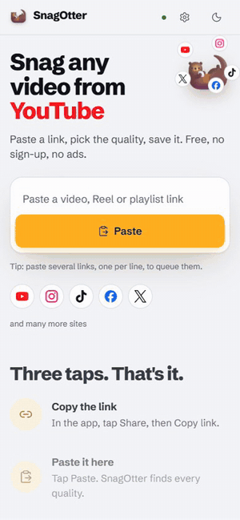
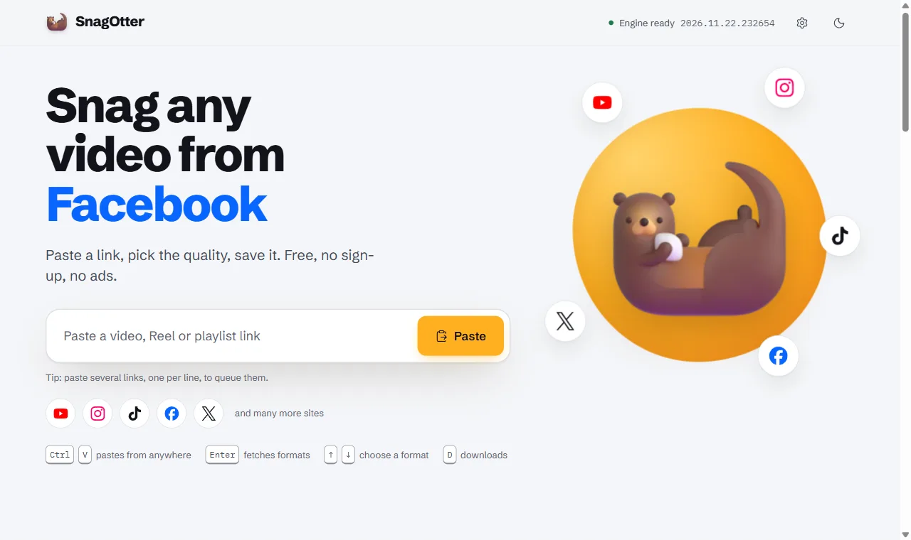
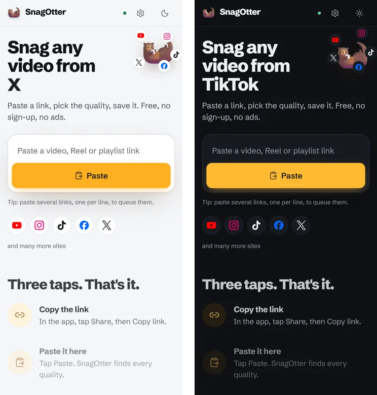
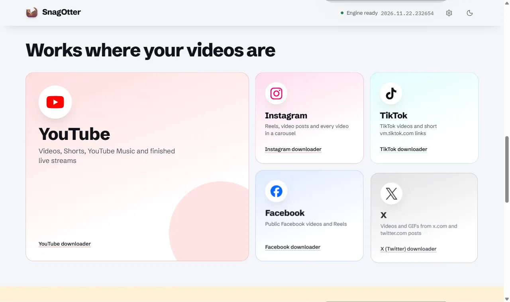
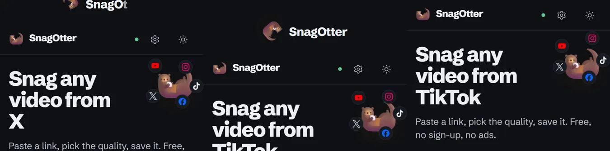
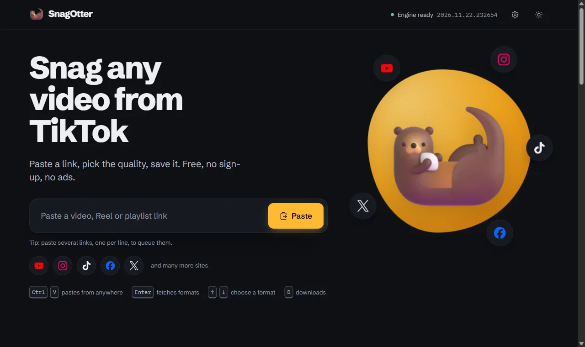

<div align="center">


# SnagOtter

**Paste a link. Get the video. No ads.**

### 👉 [snagotter.vercel.app](https://snagotter.vercel.app) 👈

YouTube · Instagram · TikTok · Facebook · X



</div>

---

## why i made this

I was tired of video downloader sites. Every one I tried was the same: three pop-up ads, a fake "Download" button that opens another ad, a 10 second countdown... and then half the time the video **didn't even download**. That pissed me off, so I made my own.

SnagOtter has no ads, no sign up and no fake buttons. You paste a link, pick the quality, and it saves. That's it.



## what it can do

- Download from **YouTube** (videos, Shorts, playlists, up to 4K), **Instagram** (Reels, posts, carousels), **TikTok**, **Facebook** and **X**
- Save just the **audio** as MP3, M4A, FLAC and more
- On iPhone, one tap **Save to Photos** puts the video straight in your camera roll
- On Android and PC the file just downloads, no extra steps
- Every file plays on any phone (it converts weird formats to normal MP4 for you)
- Works as an app: add it to your home screen and it opens like a real app
- Light and dark mode, and a little otter pull-to-refresh animation on phones

<p>

</p>

## what i used and why

I wanted it running 24/7, without my laptop on, and **completely free** (except the AWS server I already had).

| Thing | What it does here |
|---|---|
| **Vercel** | Hosts the website (the part you see). Free and fast. |
| **AWS Lightsail** | My server in Mumbai. It does the actual downloading, 24/7. |
| **Docker** | Runs everything on the server in separate boxes so nothing breaks my other stuff (n8n runs on the same server). |
| **Caddy** | Gives the server HTTPS automatically. |
| **DuckDNS** | Free domain name for the server. |
| **yt-dlp** | The open source tool that actually knows how to grab videos from each site. |
| **ffmpeg** | Joins video + audio together and converts formats. |
| **Cloudflare WARP** | Free VPN that YouTube downloads go through (see challenges). |
| **Tor** | TikTok downloads go through Tor (see challenges, this one was wild). |
| **React + Vite** | The website itself. |
| **FastAPI (Python)** | The server side that talks to yt-dlp and tracks downloads. |
| **GitHub** | Code lives here. Every push auto-deploys the site on Vercel. |

## challenges (and how i fixed them)

**1. Vercel can't download videos.**
My first plan was to put everything on Vercel. Doesn't work: Vercel functions have a time limit, can't keep a long download running, and YouTube blocks Vercel's servers anyway. So I split it in two: the website on Vercel, and the downloading on my own AWS server.

**2. YouTube blocked my server.**
YouTube can tell when a request comes from a cloud server like AWS and just says *"Sign in to confirm you're not a bot"*. Paid proxies cost money, so I routed only the YouTube traffic through **Cloudflare WARP**, which is free. Now YouTube downloads at around 30 MB/s.

**3. TikTok didn't work at all.**
This took me a while to figure out. My server is in **Mumbai**, and **TikTok is banned in India**, so every request came back as TikTok's "banned in India" page. Fix: TikTok traffic goes through **Tor**, set to only exit from countries where TikTok isn't banned. Some Tor exits are blocked by TikTok too, so it retries up to 3 times with a fresh one.

**4. Instagram Reels wouldn't download on my iPhone.**
Instagram sends Reels in a format (VP9) that can't be packed the way I was doing it, and iPhones don't like it anyway. So now it builds a normal MP4 and, if needed, converts the video to H.264, which plays everywhere.

**5. iPhones can't save to Photos from a website.**
Apple doesn't allow it. The workaround: the site loads the video first, then the **Save to Photos** button opens the iPhone share sheet, and "Save Video" puts it in Photos. One tap.

**6. Keeping it free and not filling up my server.**
Downloaded files only stay on the server for about **90 seconds** after you download them (long enough for a retry), and anything nobody picks up is deleted after **20 minutes**.

**7. The name "ytdown" was taken everywhere.**
So it became **SnagOtter** ("snag" = grab, plus an otter because why not). I checked the name was free on .com, GitHub and Vercel first.



## the pull-to-refresh i'm proud of

Pull down at the top of the page on your phone and the otter spins while the name spells itself out. Took way too long but it looks clean.



## dark mode



## run it yourself

You need Python 3.12+, Node 22+ and ffmpeg.

```powershell
git clone https://github.com/Aahil-Riyaz/snagotter.git
cd snagotter
.\start.ps1
```

On Mac/Linux use `./start.sh`. It opens on http://127.0.0.1:8787.

Want it on your own server 24/7, or all the details (settings, API, Docker, troubleshooting)? It's all in **[docs/self-hosting.md](docs/self-hosting.md)**.

## thanks to

- [yt-dlp](https://github.com/yt-dlp/yt-dlp) and [ffmpeg](https://ffmpeg.org), they do the hard part
- Otter from [Microsoft Fluent Emoji](https://github.com/microsoft/fluentui-emoji) (MIT)
- Platform logos from [Simple Icons](https://simpleicons.org) (CC0)
- Demo video is [Big Buck Bunny](https://peach.blender.org) by the Blender Foundation (CC BY 3.0)

---

<div align="center">

Made by **Aahil Riyaz Beekay**

<sub>Only download stuff you have the right to use.</sub>

</div>
